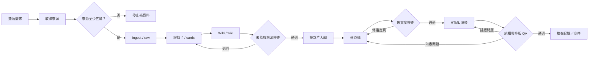

# 作業說明、實際檢查紀錄與反思

**主題：** 從材料到晶片：碳化矽（SiC）功率半導體入門  
**專案日期：** 2026/11/12  
**作業類型：** LLM Wiki → Graph / Loop → 教學 HTML 簡報  
**目前狀態：** 本機檔案已完成，公開 GitHub Pages 網址須上傳部署後補上。

## 1. LLM Wiki 主題與簡短介紹

為沒有半導體背景的讀者建立「SiC 入門」Wiki，依序介紹材料、寬能隙及其對功率電子的意義、單晶長晶、晶圓基板、CVD 磊晶、MOSFET 與應用。主題特別強調「長晶 ≠ 磊晶」和「能隙大 ≠ 電子遷移率一定更高」。Wiki 共 6 章，採用繁體中文，內容不假設讀者懂半導體製程。

**先討論後生成：** 由作業規格與既有 SiC 學習方向彙整讀者、主題、語言、資料、引用、矛盾處理、檢查與產出要求；整理成 `requirements_discussion.md`，再轉成 `AGENTS.md`，最後開始生成。**目前是依既有資訊整理的「需求提案」，不是虛構了 8～10 題逐題訪談。** 想補足老師要求的實際訪談證據，可在 Coding Agent 依需求表再完成一次訪談並截圖，將訪談結論回填 AGENTS.md。

## 2. LLM Wiki 資料來源與成果

共 **6 篇來源完成 ingest，12 張證據卡，6 個 Wiki 章節**。實作的 ingest 為將公開網頁全文或**可見的學術摘要**整理成附有原始連結、資料範圍、位置及限制的中文來源紀錄，再建立可檢索的證據卡。**不代表下載、複製或閱讀了無法存取的付費全文。**

| ID | 資料 | 可存取範圍 | 主要用途 |
|---|---|---|---|
| S01 | 美國能源部，Silicon Carbide in Integrated Energy | 公開網頁 | 基本概念與應用 |
| S02 | Liu (2022)，4H-SiC 單晶與磊晶綜述 | 公開摘要 | PVT、CVD 與長晶流程 |
| S03 | Kimoto & Cooper (2014)，SiC 磊晶書籍章節 | 公開 Summary | 磊晶主動層與厚度／摻雜控制 |
| S04 | Langpoklakpam et al. (2022)，SiC MOSFET 製程綜述 | 開放網頁全文 | 能隙參考數值、製程、MOSFET |
| S05 | Zhang et al. (2026)，CVD 磊晶缺陷綜述 | 開放網頁全文 | 缺陷控制與可靠度 |
| S06 | Viewegh et al. (2026)，寬能隙元件比較綜述 | 開放網頁全文 | SiC 特性、製程取捨 |

詳細書目及網址：`source_manifest.json`；來源整理：`raw/S01.md`～`S06.md`；證據卡：`cards/E01.md`～`E12.md`；Wiki 網頁：`wiki/index.html`；Wiki 原始知識章節：`wiki/*.md`。

### Wiki → 簡報的明確對照

| 教學內容 | Wiki 章節 | 證據卡 | HTML 頁碼 |
|---|---|---|---|
| SiC 與寬能隙 | 認識 SiC、材料特性 | E01、E02、E12 | 3–4 |
| 高耐壓與遷移率迷思 | 材料特性與效能 | E03、E08 | 5–6 |
| 由單晶到基板 | 單晶長晶與基板 | E04、E06 | 7–8 |
| CVD 磊晶與功能層 | 磊晶與功能層 | E05、E07、E11 | 9–10 |
| MOSFET 與可靠度 | MOSFET 製程與缺陷 | E07、E08 | 11 |
| 電動車、光伏與限制 | 應用與限制 | E09、E10 | 12 |
| 回顧與自我檢核 | 前述 Wiki 內容 | E02–E05 | 13 |

本作業**不以未知數據填空**。例如 4H-SiC 約 3.26 eV、Si 約 1.12 eV，都同樣採自 S04 Table 1；不同資料版本不混成同一組數值。

## 3. 教學 HTML 簡報成果

- 入口：`index.html`，Wiki：`wiki/index.html`，簡報：`slides/index.html`。
- 共 **13 頁**：由入門問題、物性圖表、長晶／磊晶流程、差異比較、MOSFET、應用到最後三題複習。
- 具上／下一頁按鈕、左右鍵、Home/End、URL `#頁碼`、搜尋 Wiki、簡報列印樣式、每頁文獻超連結。
- 純靜態 HTML/CSS/JS，無伺服器 API 依賴。直接開啟或放 GitHub Pages 均可使用；外部來源連結須有網路。

**尚未提供真實外部公開 URL**：GitHub Pages 網址必須由提交者上傳 Repository 並完成部署後複製，不能將範例網址假裝已上線。

## 4. Graph 與 Loop 的設計

主要使用 **Graph 設計節點順序與退回路線**；在逐頁寫稿、渲染／檢查中加入 **小型 Loop**。每關產物是獨立檔案，能單獨確認，不必整份重生。流程圖請見 `workflow_graph.mmd`。

**規格：**

1. **資料取得／Ingest：** 至少 5 篇，來源要有 URL、標題、存取範圍、年份。缺來源直接停下，不自行補寫。
2. **證據卡：** 只讀已 ingest 內容；每張有明確來源 ID 和原文位置。錯在證據卡即回到來源整理。
3. **Wiki 與覆蓋率關卡：** 預計的教學單元都要能查到證據；資料不足，回去補 ingest 或停下。
4. **逐頁稿：** 只看 Wiki／證據卡與大綱，需附來源；如果某頁資訊錯或太多，就只重寫該頁，最多 2 次。
5. **渲染：** 將草稿轉 HTML，不可任意新增科學結論；版面不合格只調版面。
6. **QA：** 靜態腳本檢查來源數、證據卡、引用 ID、連結、頁數；再檢查 HTML 的 JavaScript 操作；列印預覽必須剛好 13 頁。
7. **停止：** 全部可執行檢查通過即結束；單次流程最多 3 輪整體修正；資料不足或超過上限就停止交由人決定。

這種設計減少跨節點擴散錯誤。例如內容錯誤應退回逐頁稿，不該讓排版模型在 HTML 階段亂改內容。

## 5. 實際執行與檢查紀錄

本次已真正執行文件生成、靜態驗證、JS 行為模擬與列印預覽；以下不是假設情境。

| 執行紀錄 | 檢查方法 | 觀察 | 處理 |
|---|---|---|---|
| 第 1 階段 | 來源整理與建立索引 | 完成 6 篇 raw、12 張證據卡、6 篇 Wiki | 進入簡報草稿 |
| 第 2 階段 | `python qa/check.py` | **19 項 PASS、0 項 FAIL**；來源數、頁數、引用、相對連結等通過 | 進入渲染 QA |
| 第 3 階段（首次） | 使用 WeasyPrint 列印渲染 `slides/index.html` | **13 張 HTML slide 被拆成 15 張 PDF 預覽頁**；第 5、13 張發生額外分頁 | 判定為「渲染／版面」節點錯誤，不修改論文內容 |
| 第 4 階段（修正） | 固定 1280×720 列印頁面、限制 slide 高度，重新渲染 | **列印 PDF 共 13 頁**，與 13 張 HTML slide 數一致；抽查第 1、5、7、13 頁 | 修改列印 CSS，通過預覽頁數關卡 |
| 第 5 階段 | `node qa/test_interactions.js` | **12/12 PASS**：頁碼切換、方向鍵、進度、Wiki 搜尋等模擬 DOM 邏輯正確 | 保留測試紀錄 |
| 瀏覽器自動化嘗試 | Playwright + Chromium | 測試環境的管理政策攔截 `file://` 與 `localhost`，錯誤 `ERR_BLOCKED_BY_ADMINISTRATOR` | **不能宣稱真實瀏覽器自動化已通過**；請提交者在自己的電腦再檢查 |

**測試性質：** `qa/check.py` 是實際靜態測試；`qa/test_interactions.js` 是 Node 模擬 DOM 的行為測試，**不等同真實瀏覽器點擊測試**；`qa/print_preview.pdf` 是由 WeasyPrint 排版產物。執行環境阻擋的 Playwright 嘗試保留在 `qa/browser_attempt.md`，沒有刻意刪掉不利結果。

## 6. 反思：哪個節點最容易出錯？怎麼調整？

本次觀察到的**實際失誤集中在 HTML 渲染／列印版面節點**。首次完成 13 張 HTML slide，但列印結果分成 15 頁，顯示「HTML 有 13 個 section」不等於「列印或展示時一定每頁正常」。

**檢查原本太晚：** 先完成 HTML 才檢視列印結果，因此問題到成品階段才被發現。**我將版面檢查前移到每次渲染之後**：在產生 HTML 時就檢查每一張的版面設定與預覽頁數，而不是到交件階段才檢查。文字過長的問題也應提前在「逐頁稿」階段檢查字數與結構。

**Workflow 如何修改：** 增加一個「渲染 QA」小 Loop，先量測輸出頁數／版面；若有溢出，**退回渲染 CSS**，避免重新檢索 Wiki、重寫所有投影片。首次列印預覽 15 頁 → 調整 CSS → 次次預覽 13 頁，證明只修局部比整份重新生成更適合。這也符合講義所說的「錯誤要在離源頭最近的地方被抓到」。

**後續仍需人工驗收的部分：** 真實瀏覽器（電腦／手機）視覺排版、來源連結可否從學校網路打開、以及個別論文主張是否符合授課老師期待。不能將測試環境無法完成的部分誤寫為通過。

## 7. 生成式 AI 使用說明與學習收穫

本作業使用 ChatGPT 協助主題規劃、挑選及摘記可查來源、整理 Wiki／證據卡、撰寫教學文案、產生 HTML/CSS/JavaScript 與驗證腳本，以及提出 Graph/Loop 規格。來源並非無出處的 AI 虛構文章；引文以 S01～S06 對照原始網址，並清楚註明兩篇只有公開摘要／Summary 可讀。

本專案採「先安排節點、再分段產出」的做法，學到最重要的是：**不要只請 AI 說它檢查過了，應把驗證寫成可觀察的結果，並在出錯位置退回修正。** 生成式 AI 協助編寫不等於學生本人已完成所有人工檢查；提交前應閱讀、理解並依自己的實際操作補上公開網址和截圖。

### 使用過的主要提示詞摘要

- 「依老師作業要求與講義，規劃 SiC Wiki → HTML 簡報的完整流程。重點是來源可追溯、至少 ingest 5 篇、先整理需求。」
- 「主題以碳化矽功率半導體入門為主，讀者沒有相關背景；解釋長晶與磊晶的不同，避免過度推論寬能隙與遷移率。」
- 「把每篇來源整理成來源記錄，再生成證據卡；HTML 每頁都要指到 Wiki 對應的來源 ID。」
- 「將流程分成來源、證據、Wiki、大綱、逐頁稿、渲染、QA，設計退回規則與最多三輪停止條件。」
- 「真正執行檢查；遇到列印超頁只修渲染樣式，將實際錯誤和修正結果寫入報告。」

---

**繳交前待補**：學校、學號、系級、姓名、GitHub Pages 真實公開網址；使用者端打開 Wiki 與簡報截圖；必要時完成 Coding Agent 真正的需求訪談、重新檢查並將本報告中尚未完成的步驟更新。
